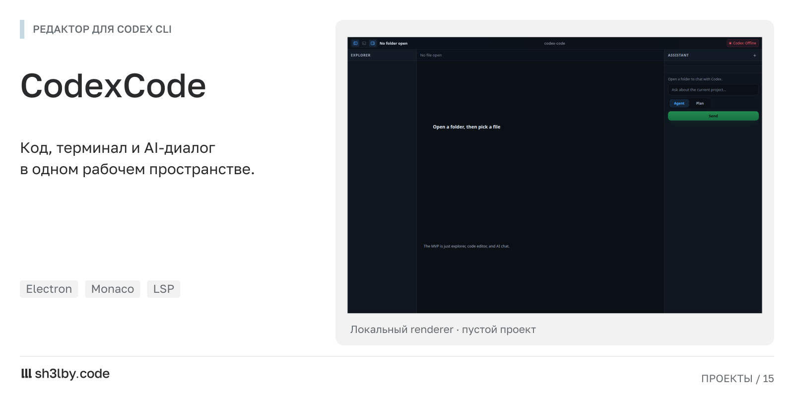

# CodexCode

<!-- portfolio-card:start -->
[](docs/portfolio/screenshot.png)

Локальное превью renderer: пустой проект, без запуска Codex, терминала и LSP. [Полный размер](docs/portfolio/screenshot.png).
<!-- portfolio-card:end -->

Работать с кодом и обсуждать изменения с агентом в одном окне. CodexCode объединяет дерево проекта, редактор Monaco, терминал и боковой чат с Codex CLI. Изменения можно посмотреть в diff, а ссылки из ответов ведут к файлам.

Задача проекта: дать локальному CLI-агенту рабочее окружение, в котором видны и диалог, и редактируемый проект. Electron-приложение запускает установленный `codex` отдельным процессом и разбирает поток его событий.

## Что показывает репозиторий

Интерфейс на React связан с файловыми сервисами, терминалом xterm/node-pty и небольшим LSP-клиентом через IPC-контракты. Мастер проекта использует шаблоны с заготовками `AGENTS.md`.

**Статус:** прототип. На карточке показан локальный renderer с пустым проектом; работа Codex, терминала и LSP этим скриншотом не подтверждается. Открытые задачи перечислены в `TODO.md`.

Обсудить похожий проект: [sh3l.beer](https://sh3l.beer).

## Компоненты

| Пакет | Назначение |
|---|---|
| `apps/desktop` | Electron-приложение на electron-vite: основной процесс, preload, React renderer и терминал xterm/node-pty |
| `packages/core` | адаптер Codex и разбор JSON-событий, сервисы файлов и workspace, diff, состояние чата, LSP-клиент и IPC-контракты |
| `packages/ui` | компоненты React: дерево файлов, чат, diff, мастер проекта и верхняя панель |
| `packages/templates` | шаблоны проектов и пресеты `AGENTS.md` |

## Запуск

Нужны Node 22+, pnpm и авторизованный `codex` CLI в PATH.

```bash
pnpm install
pnpm dev                                   # electron-vite dev with hot reload
pnpm run typecheck
pnpm run dist:linux                        # AppImage in apps/desktop/dist/
```

## Статус

Прототип. Открытые задачи находятся в `TODO.md`, исходное техническое задание в `docs/techtask.md`.

## Лицензия

MIT
